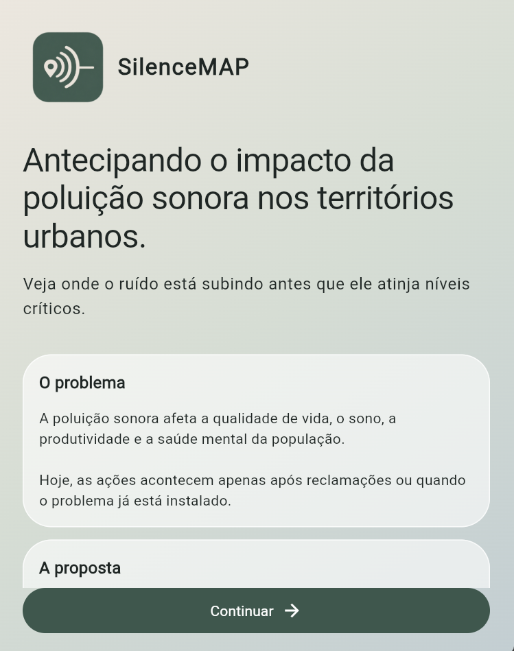
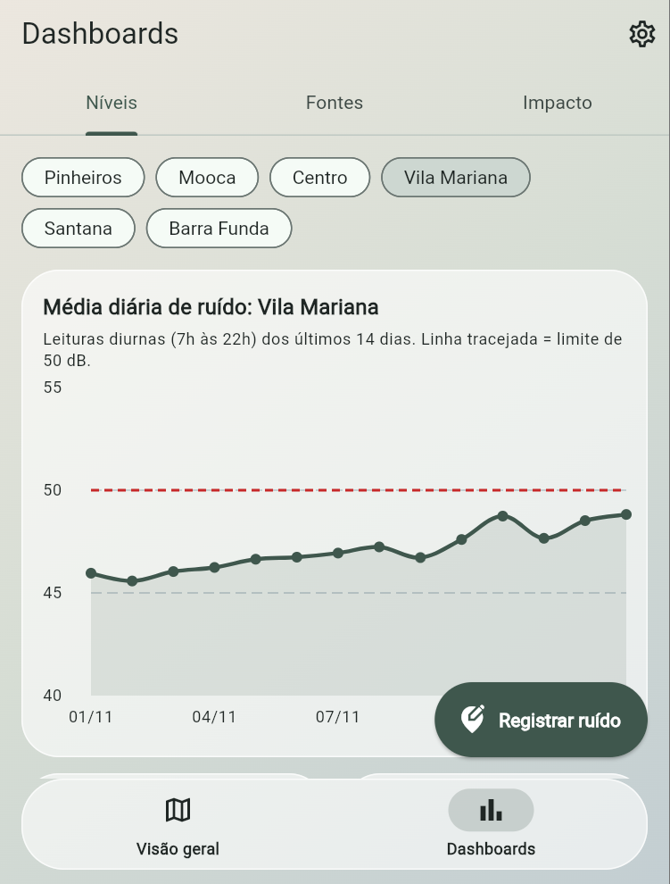
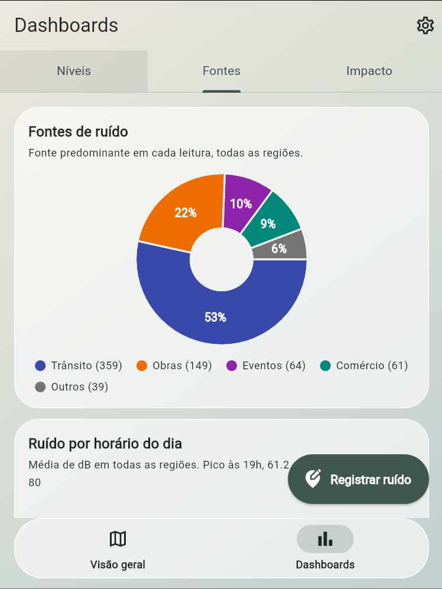
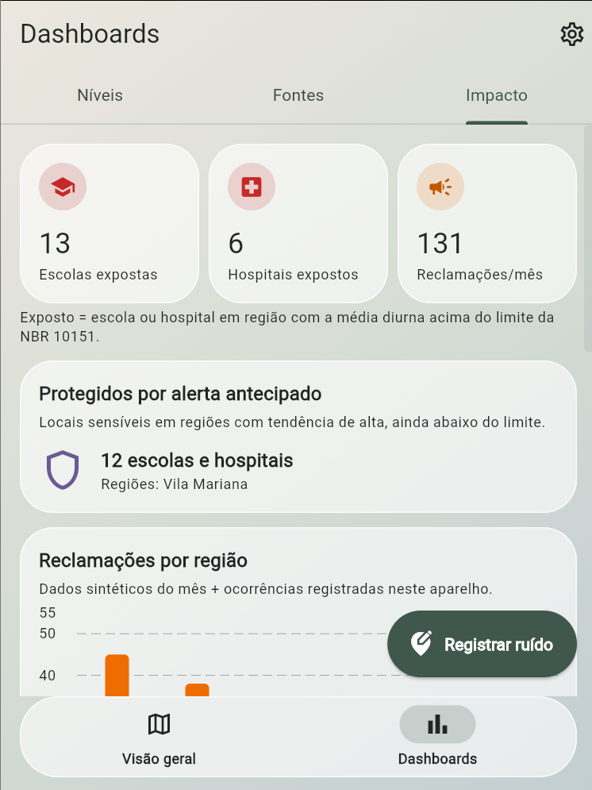
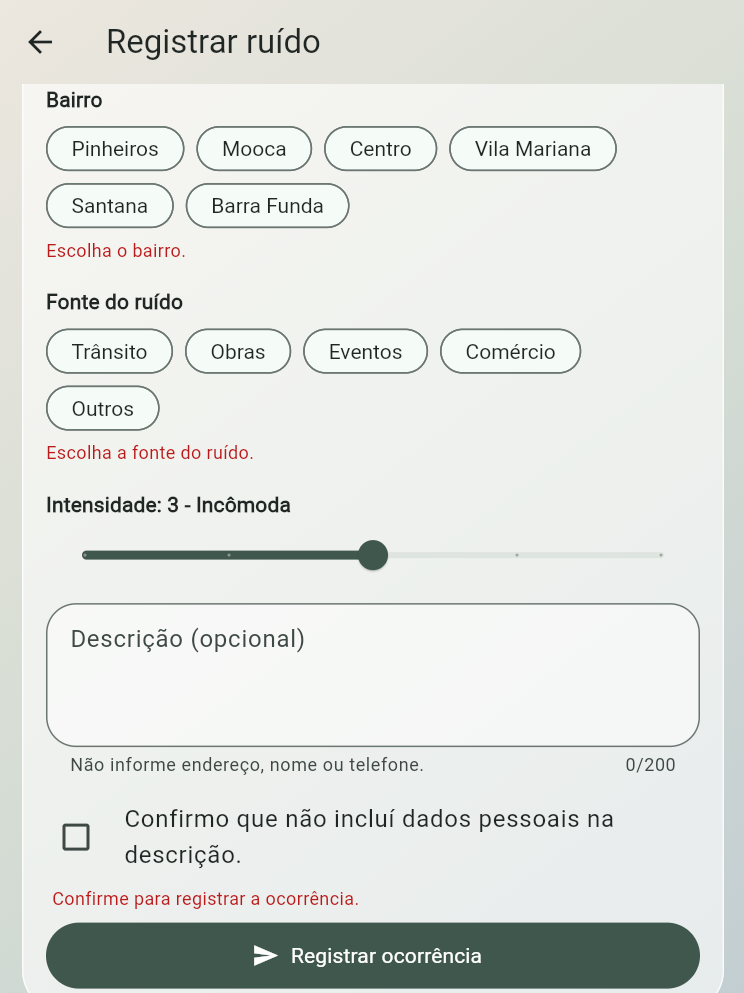
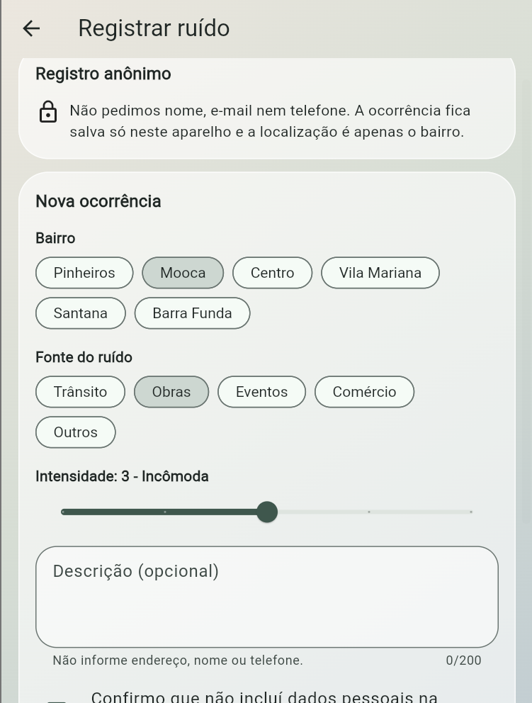
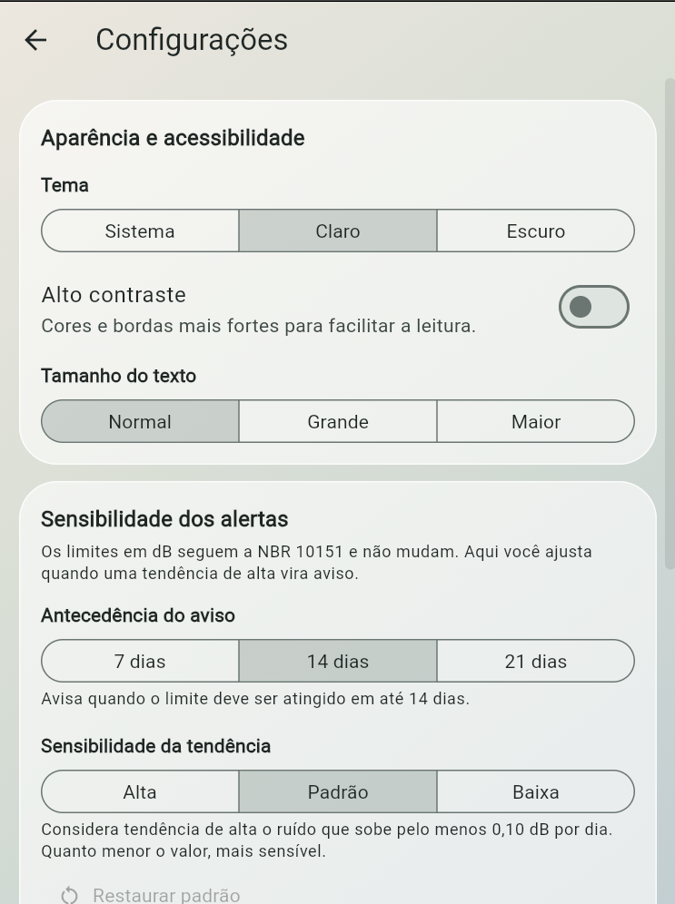
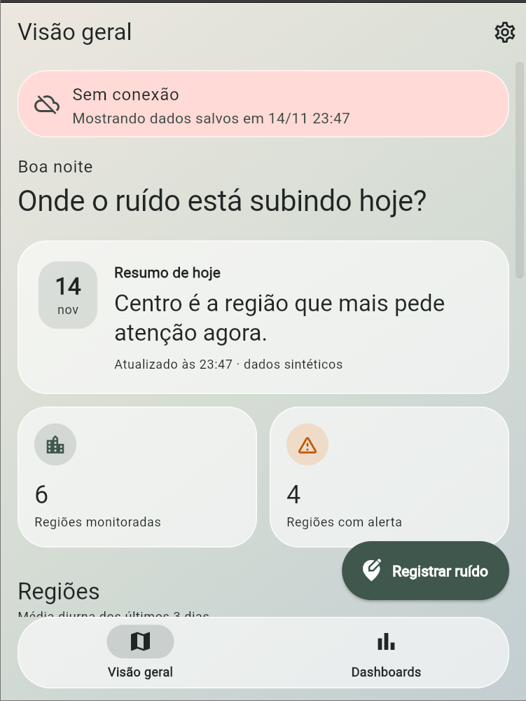

# SilenceMAP

**Antecipando o impacto da poluição sonora nos territórios urbanos.**

Aplicativo mobile desenvolvido em Flutter para monitorar indicadores de ruído urbano, analisar tendências e gerar alertas preventivos por região. A solução apresenta evidências, nível de confiança e limitações das previsões, apoiando decisões voltadas à qualidade de vida da população.

<div align="center">
  
</div>

## 1. Problema e público

A poluição sonora é um problema urbano que pode afetar a qualidade do sono, a saúde, a concentração e o bem-estar da população. Muitas vezes, as ações de prevenção acontecem somente depois de reclamações ou quando o problema já está instalado.

O **SilenceMAP** propõe uma abordagem preventiva: analisar dados de ruído por região, identificar tendências de aumento e apresentar alertas que auxiliem no planejamento de ações públicas.

**Público beneficiado:**
- Moradores de regiões urbanas;
- Trabalhadores e pessoas que estudam em áreas com exposição ao ruído;
- Escolas e hospitais;
- Gestores públicos e responsáveis pelo planejamento urbano.

**Objetivo:** transformar dados de ruído em informações compreensíveis, permitindo identificar regiões que podem atingir níveis elevados de poluição sonora.

**Impacto social esperado:** contribuir para ações preventivas, proteção de áreas sensíveis e melhoria da qualidade de vida. O aplicativo apresenta o indicador **“Protegidos por alerta antecipado”**, que contabiliza escolas e hospitais localizados em regiões com tendência de aumento do ruído, ainda abaixo do limite de referência.

## 2. Integrantes

| Nome completo | RM |
|---|---|
| Gabrielly Sousa Lorentz | 565806 |
| Maria Eduarda de Oliveira Silva Luiz | 565386 |

## 3. Demonstração visual

As imagens abaixo apresentam as principais telas e funcionalidades implementadas no aplicativo.

| Tela | Demonstração |
|---|---|
| Justificativa |  |
| Consentimento |  |
| Visão geral |  |
| Dashboard de níveis |  |
| Dashboard de fontes |  |
| Dashboard de impacto |  |
| Detalhe do alerta |  |
| Formulário com erros |  |
| Formulário preenchido |  |
| Configurações |  |
| Tema escuro |  |
| Alto contraste |  |
| Modo offline |  |

## 4. Funcionalidades

- [x] Navegação entre telas por rotas nomeadas e passagem de parâmetros.
- [x] Visão geral com resumo dos indicadores e regiões monitoradas.
- [x] Três dashboards territoriais: níveis de ruído, fontes e impacto social.
- [x] Gráficos e indicadores para análise dos dados.
- [x] Geração de alertas com justificativas, evidências, confiança e limitações.
- [x] Aviso de que os alertas apoiam, mas não substituem, a decisão humana.
- [x] Gerenciamento de estado global com Provider.
- [x] Estados de carregamento, erro e ausência de dados.
- [x] Serviço de dados sintéticos para simular a integração com uma fonte externa.
- [x] Persistência local de dados, ocorrências e preferências.
- [x] Recuperação dos últimos dados salvos quando não há conexão.
- [x] Formulário de registro de ocorrências com validação e mensagens de erro.
- [x] Indicador de benefício social relacionado à proteção de escolas e hospitais.
- [x] Consentimento explícito e possibilidade de revogação.
- [x] Tema claro, escuro e alto contraste.
- [x] Ajuste do tamanho do texto e da sensibilidade dos alertas.
- [x] Testes automatizados para regras de alertas, classificação de ruído, estatísticas, validação e persistência.

## 5. Dados e alertas

### 5.1. Fonte dos dados

O aplicativo utiliza dados **sintéticos**, gerados pelo serviço `MockNoiseApiService`. Portanto, os valores apresentados são simulados e não representam medições reais de poluição sonora.

A simulação contempla:

- Seis regiões de São Paulo: Pinheiros, Mooca, Centro, Vila Mariana, Santana e Barra Funda.
- Histórico de até 14 dias de leituras por região.
- Leituras distribuídas em intervalos de três horas.
- Diferentes perfis de ruído, tendências e fontes predominantes para cada região.
- Geração reproduzível dos dados por meio de sementes fixas.

As regiões também possuem informações simuladas sobre escolas, hospitais, reclamações e classificação de zona.

Os limites de referência por tipo de área foram adaptados da ABNT NBR 10151:2019, incluindo referências diurnas e noturnas. Esses valores são utilizados para demonstrar a lógica do aplicativo e não substituem medições técnicas ou avaliações oficiais conforme a norma.

### 5.2. Como os alertas são gerados

O processamento é realizado pelo motor de alertas localizado em `lib/logic/alert_engine.dart`.

A análise segue estas etapas:

1. **Média diária diurna:** calcula a média das leituras realizadas entre 7h e 22h, considerando dias completos.
2. **Média móvel:** calcula a média móvel de três dias para reduzir oscilações pontuais.
3. **Regressão linear:** analisa a evolução dos níveis de ruído e calcula a inclinação da tendência em dB por dia.
4. **Coeficiente R²:** avalia o quanto a tendência linear representa os dados analisados.
5. **Projeção:** estima em quantos dias o nível de ruído poderá alcançar o limite de referência.
6. **Classificação:** determina o nível de alerta conforme os limites e as condições configuradas.

### 5.3. Classificação dos alertas

| Situação identificada | Condição | Classificação |
|---|---|---|
| Limite excedido | Média móvel acima do limite da zona, até 5 dB acima | ALERTA |
| Excesso elevado | Média móvel mais de 5 dB acima do limite | CRÍTICO |
| Tendência de aumento | Ruído abaixo do limite, tendência mínima de 0,10 dB/dia, R² mínimo de 0,40 e limite projetado em até 14 dias | ATENÇÃO |
| Sem condição de alerta | Nenhuma das condições anteriores | NORMAL |
| Dados insuficientes | Menos de sete dias completos de dados | NORMAL, com baixa confiança |

Os parâmetros de tendência mínima e antecedência podem ser ajustados nas configurações do aplicativo. Os limites de referência em decibéis não são alterados pelo usuário.

### 5.4. Confiança das previsões

Cada alerta apresenta um nível de confiança — baixo, médio ou alto — considerando a quantidade de dados disponíveis e a qualidade do ajuste da regressão.

Para os alertas de tendência, um R² de pelo menos 0,70 e dez ou mais dias completos de dados permitem classificar a confiança como alta.

A confiança indica a consistência dos dados utilizados no cálculo. Ela não representa uma garantia de que o evento previsto acontecerá.

### 5.5. Métricas utilizadas

| Métrica | Finalidade |
|---|---|
| Média móvel de três dias | Suavizar oscilações dos níveis de ruído |
| Inclinação da regressão linear | Identificar a direção e a velocidade da tendência |
| R² | Avaliar a qualidade do ajuste linear |
| Projeção de dias até o limite | Estimar quando o limite poderá ser alcançado |
| Limite de referência em dB | Comparar os níveis observados com o parâmetro da zona |

### 5.6. Limitações e possíveis vieses

- **Dados sintéticos:** os valores são simulados e não representam condições reais dos bairros.
- **Histórico limitado:** a janela de até 14 dias não contempla sazonalidades, feriados ou mudanças de comportamento de longo prazo.
- **Projeção linear:** pressupõe a continuidade da tendência observada e não prevê automaticamente eventos inesperados.
- **Análise diurna:** o motor utiliza o limite diurno para a classificação apresentada, não contemplando integralmente o comportamento do ruído noturno.
- **Regiões simplificadas:** cada bairro possui uma classificação territorial predominante, que não representa todas as diferenças internas.
- **Subnotificação:** reclamações registradas podem não representar a totalidade dos problemas, pois dependem da participação da população.

### 5.7. Quando as previsões não são confiáveis

Os resultados devem ser interpretados com cautela quando:

- Existem menos de sete dias completos de dados.
- O R² é baixo e os dados apresentam oscilações sem tendência clara.
- Ocorrem mudanças repentinas, como obras, eventos ou alterações no trânsito.
- Os dados disponíveis não representam adequadamente a região analisada.

**Os alertas são ferramentas de apoio à análise. A decisão final deve ser sempre humana**, especialmente quando envolver medidas públicas ou decisões que possam afetar a população.

## 6. Privacidade e inclusão

### 6.1. Privacidade

O SilenceMAP adota medidas para reduzir a coleta e a exposição de informações pessoais:

- Consentimento explícito na primeira utilização do aplicativo.
- Possibilidade de revogar o consentimento nas configurações.
- Formulário sem solicitação de nome, e-mail ou telefone.
- Identificação territorial por bairro, sem necessidade de endereço residencial.
- Ocorrências armazenadas localmente no dispositivo.
- Validação da descrição para evitar o registro de e-mails e telefones.
- Possibilidade de excluir ocorrências individualmente ou apagar os registros armazenados.

Os dados de ocorrências são mantidos no aparelho e não são enviados a um servidor pelo fluxo de registro implementado.

### 6.2. Acessibilidade

O aplicativo disponibiliza recursos para facilitar a utilização por diferentes usuários:

- Tema claro, escuro e alto contraste.
- Ajuste do tamanho do texto.
- Descrições textuais para gráficos.
- Elementos com semântica para leitores de tela.
- Identificação de situações por texto e ícones, não somente por cores.
- Títulos e componentes organizados para facilitar a leitura.
- Áreas de toque adequadas nos principais controles.

Esses recursos buscam tornar a interface mais compreensível e acessível, inclusive para pessoas que utilizam tecnologias assistivas.

## 7. Tecnologias e decisões técnicas

| Tecnologia | Utilização |
|---|---|
| Flutter | Desenvolvimento da aplicação mobile multiplataforma |
| Dart | Linguagem de programação |
| Provider | Gerenciamento de estado global |
| fl_chart | Construção dos gráficos e visualizações |
| shared_preferences | Persistência local de dados e preferências |
| intl | Formatação de datas |
| flutter_test | Testes automatizados |
| flutter_lints | Análise e padronização do código |

### 7.1. Arquitetura do projeto

A aplicação foi organizada em camadas para separar responsabilidades e facilitar a manutenção.

```text
lib/
├── main.dart
├── core/
│   ├── theme/
│   │   ├── app_theme.dart
│   │   ├── app_colors.dart
│   │   └── glass_style.dart
│   └── routes/
│       └── app_routes.dart
├── models/
│   ├── noise_reading.dart
│   ├── alert_config.dart
│   ├── noise_data.dart
│   ├── region.dart
│   └── occurrence.dart
├── data/
│   ├── services/
│   │   └── mock_noise_api_service.dart
│   └── repositories/
│       └── noise_repository.dart
├── logic/
│   ├── alert_engine.dart
│   ├── noise_stats.dart
│   ├── occurrence_validator.dart
│   └── noise_level.dart
├── providers/
│   ├── settings_provider.dart
│   └── noise_provider.dart
└── ui/
    ├── screens/
    └── widgets/

test/
├── alert_engine_test.dart
├── mock_api_test.dart
├── noise_level_test.dart
├── noise_stats_test.dart
├── occurrence_test.dart
└── repository_test.dart
```

**Separação de responsabilidades:**

- `models`: representa as entidades e estruturas de dados.
- `data`: contém o serviço de dados simulados e o repositório responsável pela integração com o armazenamento local.
- `logic`: concentra cálculos, classificação, validações e geração de alertas.
- `providers`: controla e compartilha o estado da aplicação.
- `ui`: reúne as telas e componentes visuais reutilizáveis.
- `core`: centraliza configurações de tema e rotas.

Essa organização evita concentrar regras de negócio diretamente nas telas e facilita a manutenção e os testes da aplicação.

## 8. Como executar

### 8.1. Pré-requisitos

- Flutter instalado.
- Dart compatível com a versão definida no `pubspec.yaml`.
- Android Studio ou Visual Studio Code.
- Emulador Android, dispositivo físico ou navegador Chrome.

Verifique a instalação:

```bash
flutter doctor
```

### 8.2. Clonar o repositório

```bash
git clone [https://github.com/gabylorentz/SilenceMAP---CitizenTech]
cd silencemap_estrutura
```

### 8.3. Instalar as dependências

```bash
flutter pub get
```

### 8.4. Executar o aplicativo

```bash
flutter run
```

Para executar no Chrome:

```bash
flutter run -d chrome
```

### 8.5. Executar os testes

```bash
flutter test
```

### 8.6. Analisar o código

```bash
flutter analyze
```

### 8.7. Gerar APK

Para gerar uma versão de lançamento:

```bash
flutter build apk --release
```

O arquivo gerado estará em:

```text
build/app/outputs/flutter-apk/app-release.apk
```

**Configuração:** o projeto utiliza dados sintéticos e armazenamento local, não exigindo chaves de API ou variáveis de ambiente para a execução padrão.

## 9. Vídeo de demonstração

O vídeo apresenta o problema abordado, a proposta do SilenceMAP e a demonstração das principais funcionalidades, incluindo dashboards, alertas, formulário, configurações e modo offline.

**Link:** https://youtu.be/GiCKyaFmXo8?is=bzHzWVCCfig-BmlG

## 10. Licença

Projeto acadêmico desenvolvido para a FIAP, como parte da Global Solution 2026.2, na disciplina **Cross-Platform Application Development**, dentro do desafio **Territory Predictive Insights**.

Todos os direitos relacionados ao desenvolvimento acadêmico pertencem aos integrantes do projeto.

---

**SilenceMAP — dados para antecipar problemas e apoiar territórios mais saudáveis.**
