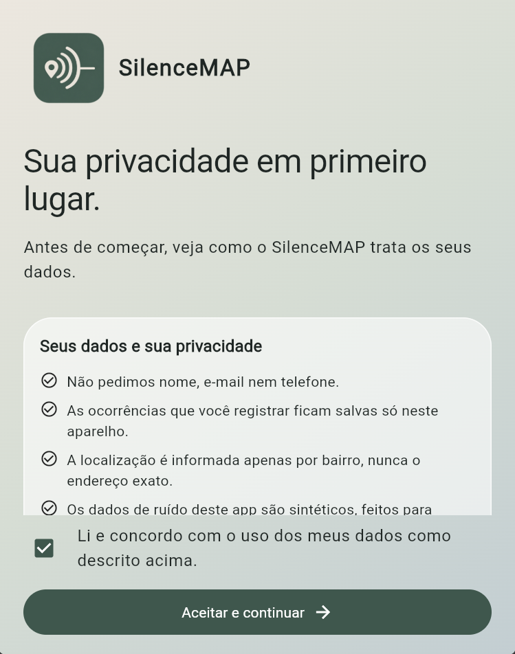
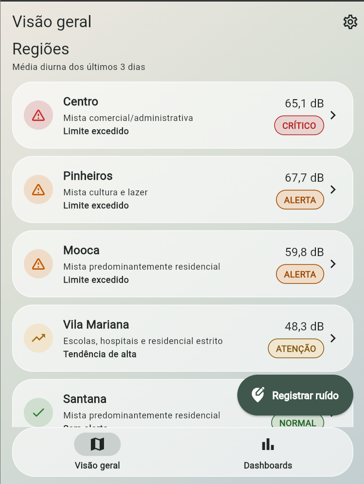
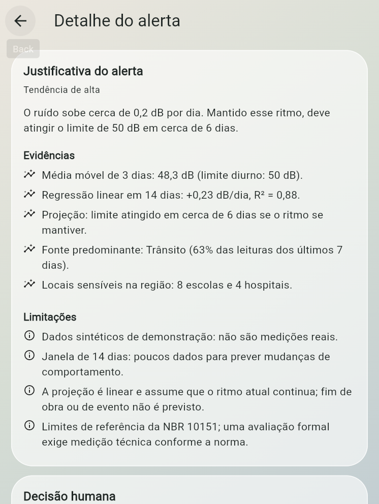
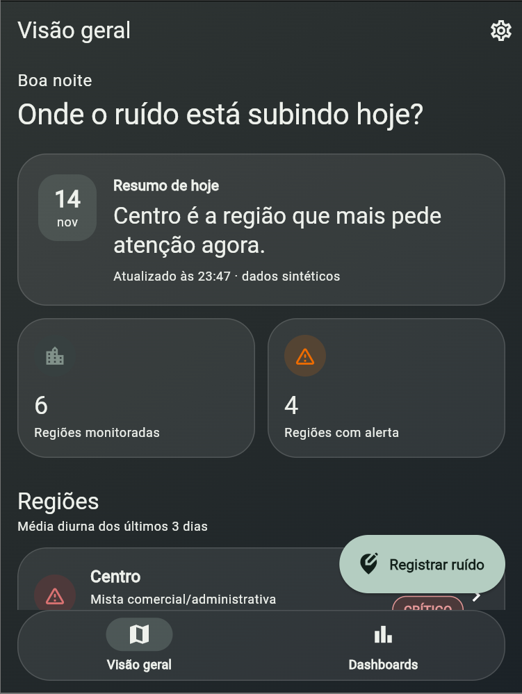
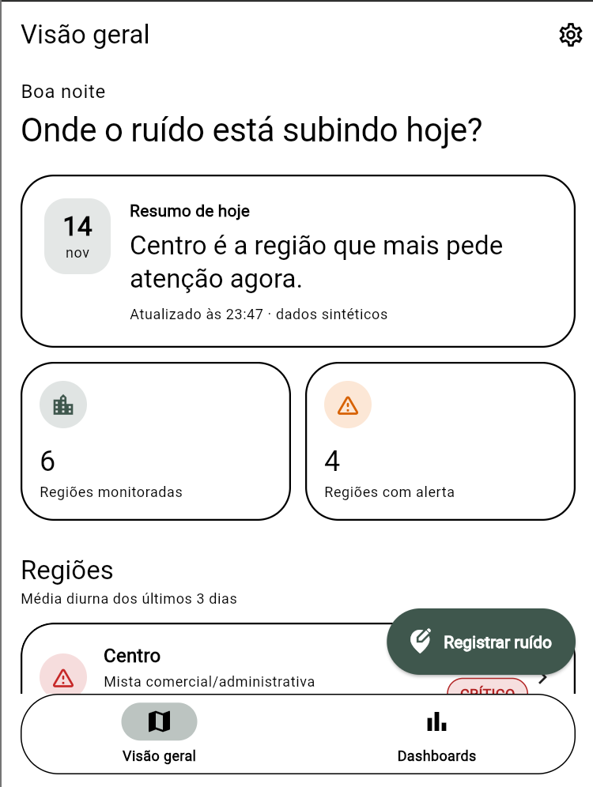

<div align="center">


# SilenceMAP

**Antecipando o impacto da poluição sonora nos territórios urbanos.**

App mobile em Flutter que identifica regiões com tendência de aumento de ruído urbano antes que o problema se instale, e explica cada alerta com justificativa, nível de confiança e limitações.

</div>

---

## 1. Problema e público

**Problema.** A poluição sonora afeta a qualidade de vida, o sono, a produtividade e a saúde mental da população. Hoje, as ações acontecem apenas depois de reclamações ou quando o problema já está instalado. O SilenceMAP busca antecipar regiões com tendência de aumento do ruído urbano.

**Público.**
- Moradores
- Trabalhadores remotos
- Escolas
- Hospitais
- Gestores públicos

**Impacto social esperado.** Identificar áreas com tendência de aumento de ruído antes que atinjam níveis críticos, apoiando decisões preventivas e melhorando a qualidade de vida da população. O app mostra o indicador **"Protegidos por alerta antecipado"**: quantas escolas e hospitais estão em regiões com tendência de alta, ainda abaixo do limite.

## 2. Integrantes

| Nome completo | RM |
|---|---|
| [Gabrielly Sousa Lorentz] | [565806] |
| [Maria Eduarda de Oliveira Silva Luiz ] | [565386] |

## 3. Demonstração visual

| | | |
|:---:|:---:|:---:|
| <br>**Justificativa:** primeira tela, explica o problema e o público | <br>**Consentimento:** privacidade e aceite explícito | <br>**Visão geral:** resumo do dia e regiões ordenadas por gravidade |
| <br>**Dashboard Níveis:** média diária e limite da norma | <br>**Dashboard Fontes:** fontes e horários de pico | <br>**Dashboard Impacto:** escolas, hospitais e reclamações |
| <br>**Detalhe do alerta:** justificativa, evidências, confiança e limitações | <br>**Formulário:** validação com feedback de erro | <br>**Minhas ocorrências:** registro anônimo salvo no aparelho |
| <br>**Configurações:** acessibilidade, sensibilidade e privacidade | <br>**Tema escuro** | <br>**Alto contraste** |
| <br>**Modo offline:** dados salvos quando não há conexão | | |

## 4. Funcionalidades

- [x] 7 telas com navegação por rotas nomeadas: Justificativa, Consentimento, Visão geral, Dashboards, Detalhe do alerta, Registrar ruído e Configurações
- [x] 3 dashboards: Níveis de ruído, Horários e fontes, Impacto social
- [x] Alertas gerados a partir dos dados, com justificativa, evidências, nível de confiança e limitações
- [x] Aviso visível de que o alerta apoia, mas não substitui, a decisão humana
- [x] Estado global (Provider) compartilhado entre Visão geral, Dashboards, Detalhe do alerta, Formulário e Configurações
- [x] Estados de carregamento, erro e lista vazia
- [x] API simulada com dados sintéticos
- [x] Persistência local: cache dos dados, ocorrências e preferências
- [x] Modo offline: sem conexão, o app mostra os últimos dados salvos
- [x] Formulário com validação e feedback visual de erro
- [x] Indicador de benefício social: "Protegidos por alerta antecipado"
- [x] Identidade visual própria e consistente: fundo em degradê suave, cartões translúcidos, botões em pílula e navegação flutuante, definidos em um tema único e componentes reutilizáveis
- [x] Tema claro e escuro, alto contraste e tamanho de texto ajustável
- [x] Sensibilidade dos alertas ajustável pelo usuário
- [x] Testes automatizados (lógica, persistência e layout em vários tamanhos de tela)

## 5. Dados e alertas

### Fonte dos dados
Os dados são **sintéticos**, gerados por uma API simulada (`MockNoiseApiService`). **Não são medições reais.**
- 6 regiões de São Paulo: Pinheiros, Mooca, Centro, Vila Mariana, Santana e Barra Funda.
- 14 dias de leituras por região, uma a cada 3 horas.
- Cada região tem um perfil próprio (nível base, tendência e fontes de ruído), para os alertas contarem histórias diferentes.
- A geração usa semente fixa: os dados são reproduzíveis.
- Os limites de referência por tipo de área são **adaptados da NBR 10151:2019** (por exemplo, 50 dB de dia e 45 dB à noite em áreas sensíveis). Uma avaliação formal exige medição técnica conforme a norma.

### Como os alertas são gerados
O motor de alertas (`lib/logic/alert_engine.dart`) analisa cada região assim:

1. Calcula a **média diária diurna** (7h às 22h), usando só dias completos, com as 5 leituras diurnas.
2. Calcula a **média móvel de 3 dias**, que suaviza a oscilação de cada dia.
3. Ajusta uma **regressão linear** nos dias analisados, para obter a tendência (dB por dia) e o **R²**, que diz quão bem a reta explica os dados.
4. Classifica o resultado:

| Resultado | Condição | Nível |
|---|---|---|
| Limite excedido | Média móvel acima do limite diurno da zona | **ALERTA** (até 5 dB acima) ou **CRÍTICO** (mais de 5 dB acima) |
| Tendência de alta | Abaixo do limite, tendência de pelo menos 0,10 dB/dia, R² de pelo menos 0,40 e limite atingido em até 14 dias | **ATENÇÃO** |
| Sem alerta | Nenhuma das condições acima | **NORMAL** |
| Dados insuficientes | Menos de 7 dias completos | **NORMAL** (confiança baixa) |

A tendência mínima (0,05, 0,10 ou 0,20 dB/dia) e a antecedência (7, 14 ou 21 dias) podem ser ajustadas em **Configurações**. Os limites em dB não mudam.

Cada alerta mostra: resumo, evidências, nível de confiança (**Baixa**, **Média** ou **Alta**), limitações e o aviso de decisão humana. A confiança é **Alta** com 10 ou mais dias completos e, no alerta de tendência, com R² de pelo menos 0,70.

### Métricas usadas
Média móvel de 3 dias (dB), inclinação da reta (dB/dia), R², projeção de dias até o limite, limite diurno da zona (dB).

### Limitações e vieses
- **Dados sintéticos:** os perfis foram desenhados pelos autores e não representam o ruído real dos bairros.
- **Janela curta:** 14 dias não captam sazonalidade, feriados ou mudanças de comportamento.
- **Projeção linear:** assume que o ritmo atual continua. Fim de obra ou de evento não é previsto.
- **Só o período diurno:** o motor usa o limite diurno. Ruído noturno e picos curtos não geram alerta.
- **Zonas simplificadas:** cada bairro tem um único tipo de área, o que não reflete a variação dentro dele.
- **Viés de subnotificação:** as reclamações dependem de quem registra. Regiões com menos acesso ao app tendem a aparecer menos.

### Quando as previsões não são confiáveis
- Com menos de 7 dias completos de dados.
- Quando o R² é baixo: os dados oscilam sem direção clara.
- Diante de mudanças bruscas, como início ou fim de obra e eventos pontuais.
- Para decisões de alto impacto: o alerta é um apoio, **a decisão final é sempre humana**.

## 6. Privacidade e inclusão

### Privacidade
- **Consentimento explícito** na primeira abertura, com texto claro. Pode ser revogado em Configurações.
- **Anonimato:** o app não pede nome, e-mail nem telefone.
- **Localização só por bairro**, nunca o endereço exato.
- **Dados só no aparelho:** as ocorrências ficam salvas localmente e não são enviadas a nenhum servidor.
- **Validação contra dados pessoais:** o formulário recusa e-mail e telefone na descrição e exige a confirmação de que não há dados pessoais.
- **Controle do usuário:** é possível excluir uma ocorrência, apagar todas e revogar o consentimento.

### Acessibilidade
- **Contraste:** o texto do app tem contraste muito acima de 4,5:1 sobre o degradê. As etiquetas de nível ajustam a cor do texto para atingir pelo menos 4,5:1 em qualquer tema, e os ícones coloridos ajustam a cor para pelo menos 3:1 (verificado por teste automatizado).
- **Cor não é o único sinal:** cada situação da região tem também um ícone e um texto próprios.
- **Alto contraste:** fundo liso, cores e bordas mais fortes. Também liga sozinho se o sistema operacional pedir.
- **Tema claro, escuro ou do sistema.**
- **Tamanho do texto:** Normal, Grande ou Maior (até 1,3 vez), multiplicando a configuração do sistema.
- **Leitores de tela:** cartões de região lidos como botão, títulos marcados como cabeçalho e cada gráfico com uma descrição em texto.
- **Área de toque** de pelo menos 48 px nos botões principais.

## 7. Tecnologias e decisões técnicas

| Escolha | Por quê |
|---|---|
| **Flutter** | Um só código para Android e iOS, como pede a disciplina |
| **Provider** | Estado global simples e testável, suficiente para o escopo do app |
| **fl_chart** | Gráficos de linha, pizza e barras nativos, sem WebView |
| **shared_preferences** | Persistência leve para cache, ocorrências e preferências |
| **intl** | Formatação de datas |
| **API simulada** | Permite simular erro e falta de conexão, com dados reproduzíveis |
| **Tema único com `ThemeExtension`** | Concentra cores, degradê e cartões em um só lugar, sem repetir estilos tela a tela |

### Arquitetura
```
lib/
├── main.dart
├── core/
│   ├── theme/          # cores, tema claro/escuro, alto contraste e estilo de vidro
│   └── routes/         # rotas nomeadas
├── models/             # Region, NoiseReading, Occurrence, AlertConfig
├── data/
│   ├── services/       # API simulada
│   └── repositories/   # junta API + cache local
├── logic/              # motor de alertas, estatísticas, validação
├── providers/          # estado global (ruído e configurações)
└── ui/
    ├── screens/        # telas
    └── widgets/        # componentes reutilizáveis
```
As telas só leem do Provider, que só fala com o repositório. A lógica de alertas, estatísticas e validação fica fora das telas e é testada sozinha.

## 8. Como executar

**Requisitos:** Flutter instalado (`flutter doctor` sem erros) e um emulador Android, um aparelho físico ou o Chrome.

```bash
git clone https://github.com/[USUARIO]/[REPOSITORIO].git
cd [REPOSITORIO]
flutter pub get
flutter run
```

**Variáveis de ambiente:** não há. O app usa dados sintéticos e não precisa de chaves de API.

**Testes e análise:**
```bash
flutter test
flutter analyze
```

**Gerar o APK (opcional):**
```bash
flutter build apk --release
```
O arquivo fica em `build/app/outputs/flutter-apk/app-release.apk`.

## 9. Vídeo

[Assistir ao vídeo de demonstração](https://[LINK_DO_VIDEO])

## 10. Licença

Projeto acadêmico, FIAP, Global Solution 2026.2.
